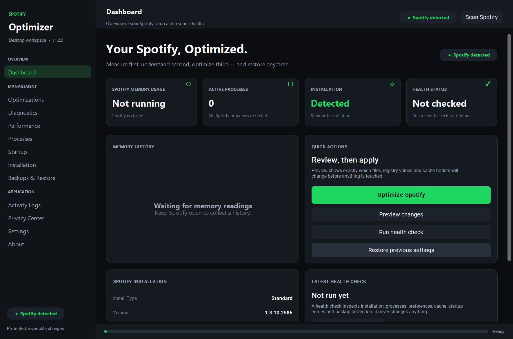
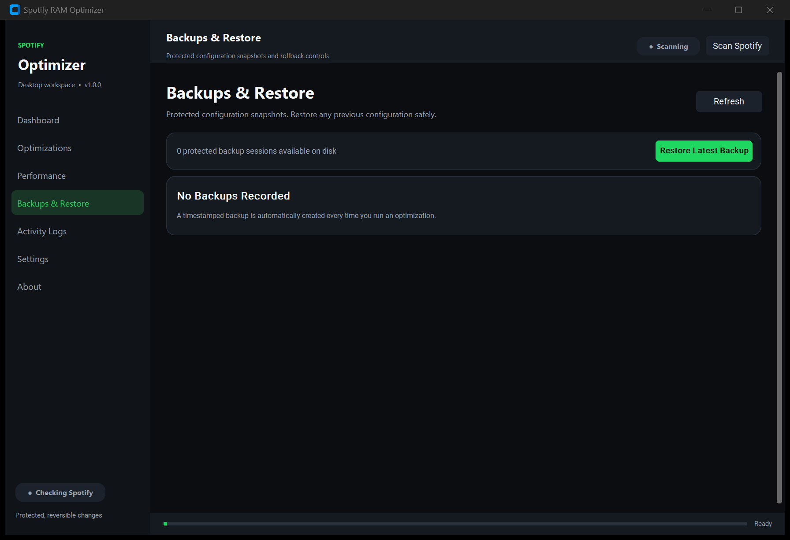

# Spotify RAM Optimizer

**Spotify Optimizer — Take Control of Your Spotify Performance.**

Monitor, manage, and optimize Spotify on Windows with a powerful desktop utility built for performance, control, and reliability.

*Designed and developed by **Icey**.*

A lightweight Windows utility for optimizing background resource usage of Spotify Desktop and Microsoft Store editions. It applies reversible, user-selected settings and safe cache cleaning while keeping login credentials, playlists, and offline media untouched.

---

## Downloads

Download the pre-compiled standalone executable from GitHub Releases:

- **[SpotifyOptimizer.exe (v1.0.0)](https://github.com/Icey067/spotify-ram-optimizer/releases/download/v1.0.0/SpotifyOptimizer.exe)** (Direct Download, ~32.7 MB)
- **[All Releases & Release Notes](https://github.com/Icey067/spotify-ram-optimizer/releases)**

No Python installation or dependencies are required to run the standalone executable.

---

## Core Capabilities

- **Automatic Environment Detection**: Discovers both standard Win32 Spotify installations and sandboxed Microsoft Store packages (`SpotifyAB.SpotifyMusic`).
- **Spicetify Compatibility**: Safe for default Spotify installations and setups using Spicetify.
- **Resource Telemetry**: Live multi-process CPU, memory, and process count tracking.
- **Selective Cache Purging**: Purges temporary web and code cache without removing audio tracks, database files, or session tokens.
- **Hardware Acceleration & Preference Tuning**: Adjust graphics acceleration, memory limits, and Windows autostart entries via the user interface.
- **Automatic Restore Snapshots**: Creates a timestamped backup before applying changes, enabling instant one-click rollback.
- **Non-Elevated Execution**: Operates entirely within standard user permissions without requiring administrator rights.

---

## Screenshots

### Main Dashboard


### Optimization Controls


### Real-Time Performance


### Backups and Rollback


---

## Safety Guarantees

The application enforces strict protection boundaries:

- **Login & Auth**: Authentication tokens, cookies, and credentials are never inspected or modified.
- **Offline Content**: Downloaded music files, local audio tracks, and user playlists are explicitly excluded from cache cleanups.
- **Idempotent Tweaks**: Preferences and registry settings can be applied and reverted repeatedly without side effects.
- **Automatic Backups**: Backups are stored locally under the user profile and can be restored at any time.

---

## Running from Source

### Prerequisites
- Windows 10 or Windows 11
- Python 3.11 or later

### Installation Steps

```powershell
# Clone the repository
git clone https://github.com/Icey067/spotify-ram-optimizer.git
cd spotify-ram-optimizer

# Install dependencies
python -m pip install -r requirements.txt

# Run the application
python main.py
```

---

## Testing

Run the full automated test suite using pytest:

```powershell
python -m pytest tests/ -v
```

All 78 unit, integration, and UI navigation tests pass with zero failures.

---

## Building the Standalone Executable

To compile the standalone binary locally:

```powershell
python -m PyInstaller --clean --noconfirm `
  --distpath release --workpath .release-build spotify_optimizer.spec
```

The output executable is generated at `release/SpotifyOptimizer.exe`.

---

## Repository Structure

- `src/core/`: Optimization engine, process manager, detector, cache manager, and backup utilities.
- `src/gui/`: CustomTkinter user interface components, navigation controller, and page views.
- `tests/`: 78 automated tests covering all modules and navigation states.
- `release/`: Production standalone Windows binary.
- `docs/`: Release notes, documentation, and interface screenshots.
- `main.py`: Application entry point and smoke-test CLI.

---

## Author & Credits

Designed and developed by **Icey** ([@Icey067](https://github.com/Icey067)).

---

## License

This project is open source and available under the MIT License.
