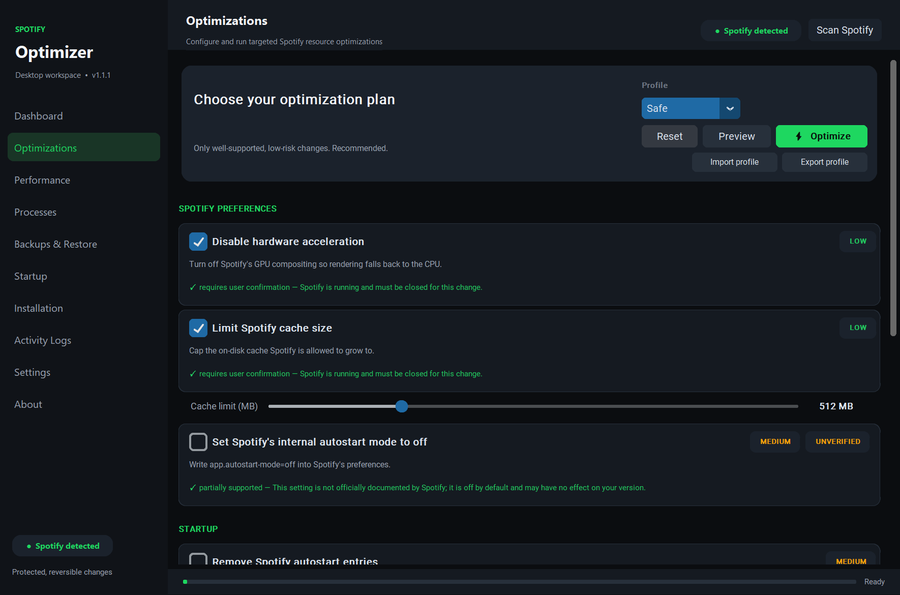
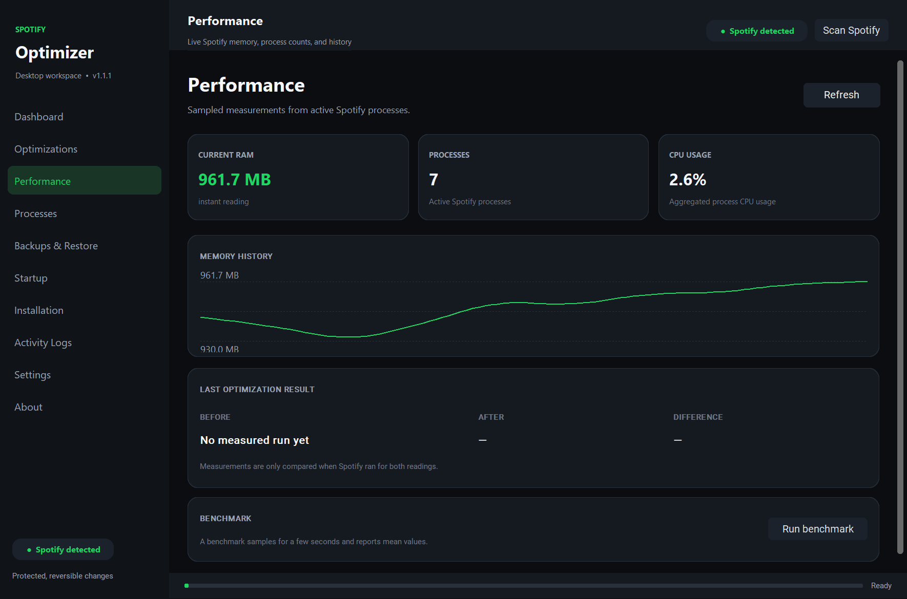
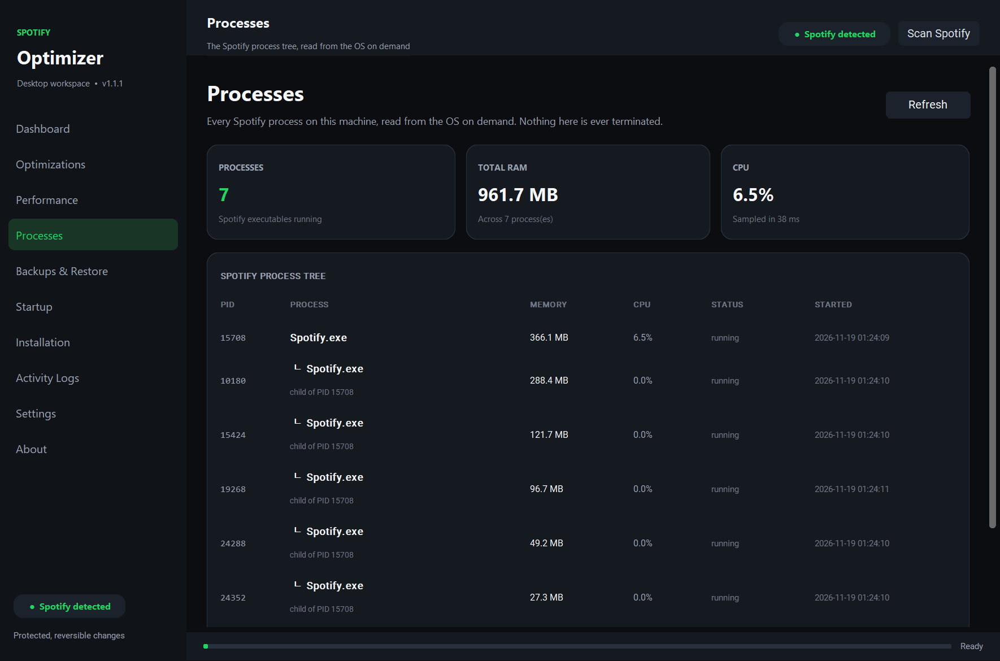
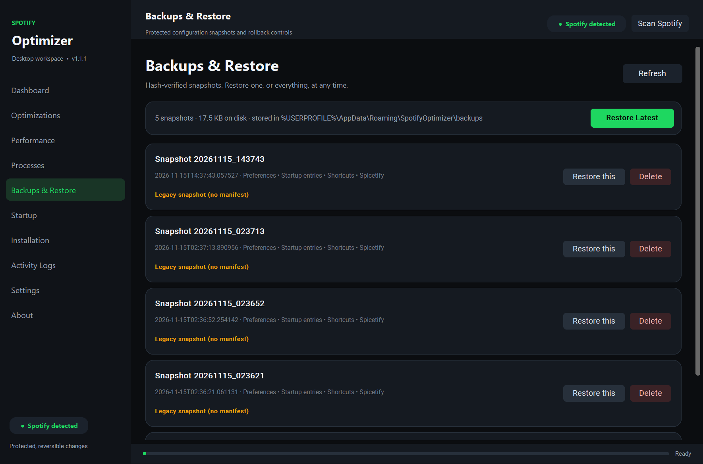
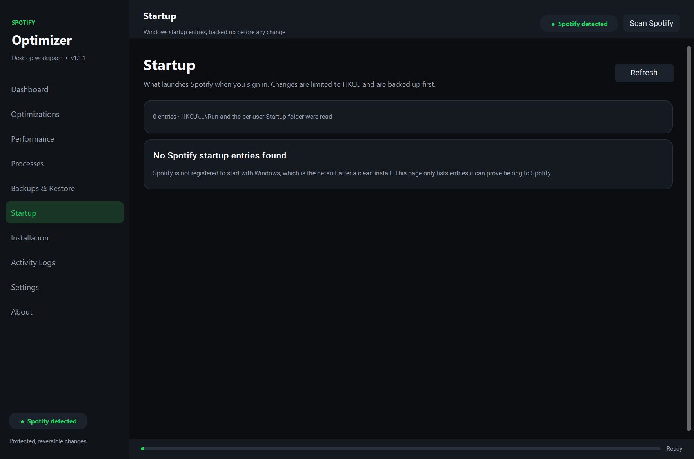
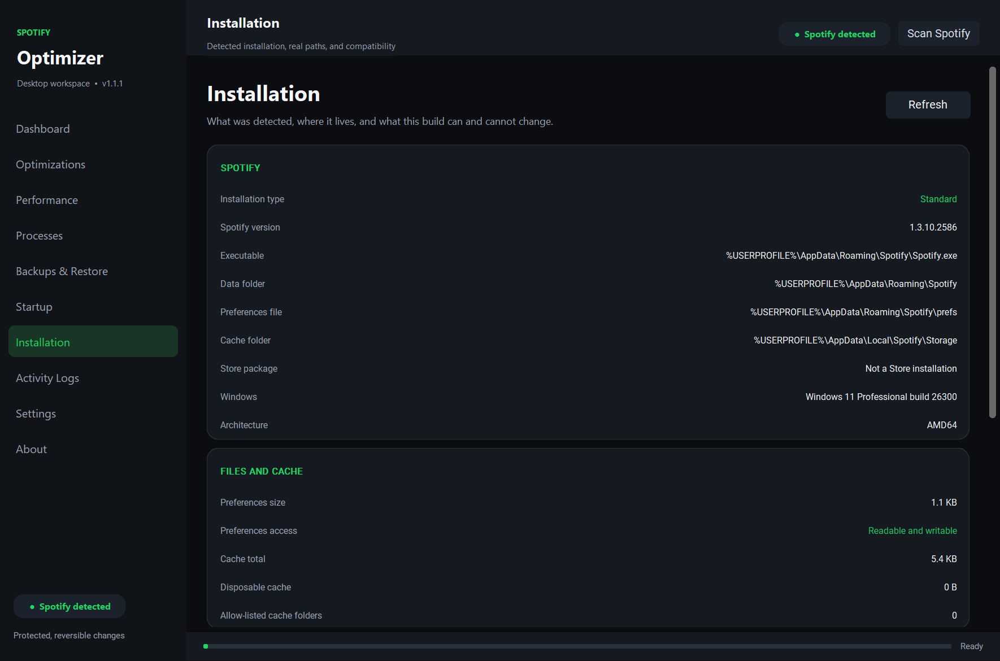
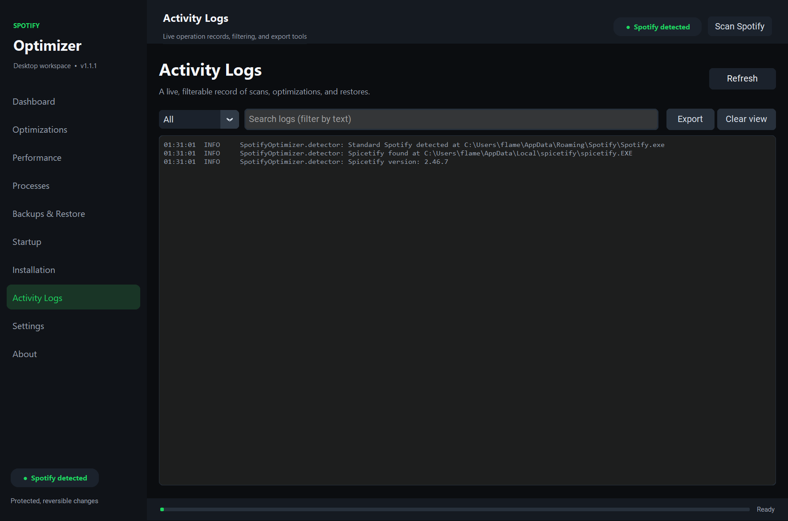
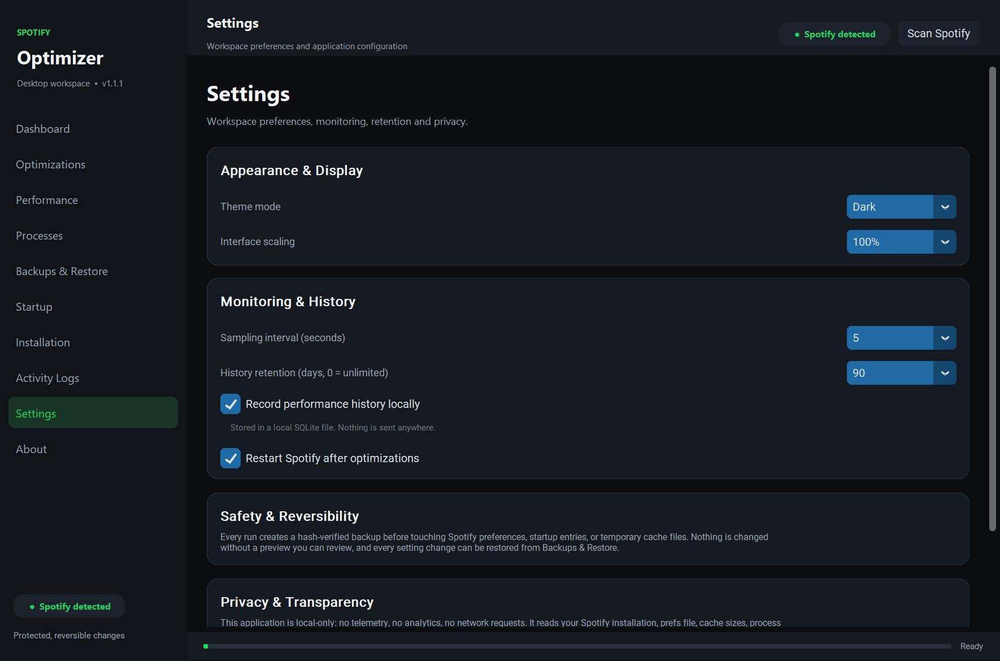
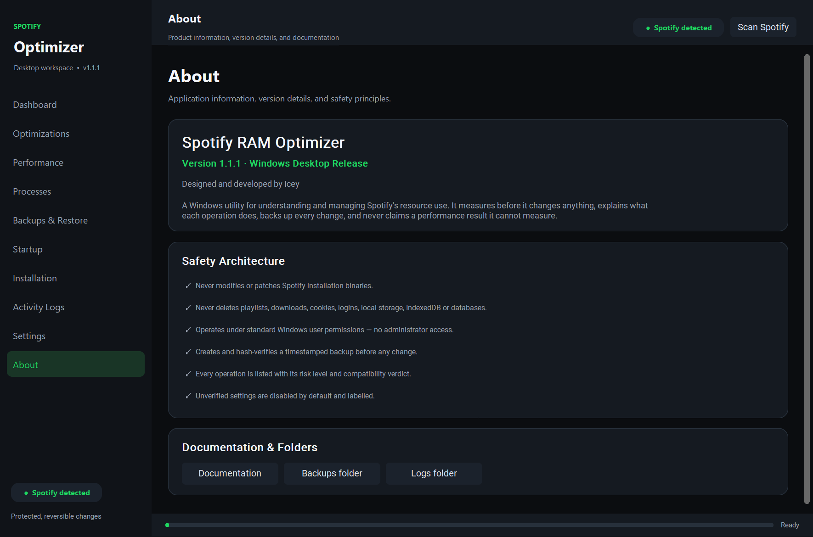

# Spotify Optimizer

**Take Control of Your Spotify Performance on Windows.**

A Windows utility that measures Spotify's resource use, explains what each change does, and keeps every change reversible.

**Current release: v1.1.1** — built, tested and verified locally. Not published.

[](https://github.com/Icey067/spotify-ram-optimizer/actions/workflows/ci.yml)
[](LICENSE)

*Designed and developed by **Icey** ([@Icey067](https://github.com/Icey067)).*

---

## What this actually is

Spotify RAM Optimizer inspects your Spotify Desktop installation and offers a
small set of **evidence-based, reversible** changes: a preference tweak that
Spotify itself exposes, a cache-size cap, clearing disposable caches, removing
Spotify's Windows autostart entry, and trimming Spicetify extensions.

It is deliberately **not** a registry-tweak collection. There are no "secret"
optimizations, no memory cleaners, and no claims that closing Redis will give
you 4 GB back. The core rule is:

> Measure first. Understand second. Optimize third. Verify always. Restore whenever necessary.

### What you get

| Capability | Detail |
| --- | --- |
| Plan preview (dry run) | Shows the exact prefs keys, registry values and cache directories that would change, before anything is touched. |
| Hash-verified backups | Every run writes a manifest with SHA-256 for each artefact and verifies it before applying a single change. |
| Per-change verification | Each change is re-read after writing; a mismatch is reported as a failure, not a success. |
| Transactional rollback | If a critical preference write fails, applied preference and startup changes are restored from the captured values. |
| Restore with conflict detection | Restoring never silently overwrites Spotify preferences that changed after the snapshot; you are asked first. |
| Honest benchmarking | Mean working set, private memory (when exposed) and CPU sampled over a window, with an explicit "not comparable" result when Spotify was closed for one reading. |
| Health check | Installation, preferences, cache, startup, Spicetify, backups and live performance, each with evidence and a severity. |
| Local performance history | SQLite in your own profile. No telemetry, no network calls at all. |
| Privacy page | Exactly which paths are read and written, with one-click clearing of logs and history. |

---

## Requirements

- Windows 10 (build 10240+) or Windows 11, 64-bit
- Python 3.11+ **only if you run from source**; the executable is standalone
- Standard Spotify Desktop installation

No administrator rights are required. The application never elevates.

---

## Downloads

- **Latest published release: [v1.0.0](https://github.com/Icey067/spotify-ram-optimizer/releases)** — the original seven-page interface.
- **v1.1.1 (this source tree) is not published yet.** It is built and verified locally; the binary is committed at `release/SpotifyOptimizer.exe`. Build instructions, the verification table and the current SHA-256 are in [`docs/RELEASE_NOTES.md`](docs/RELEASE_NOTES.md). Publishing a release is a deliberate, manual step — nothing has been tagged or pushed.
- **The committed binary predates the Diagnostics and Privacy Center pages.** Those two pages exist in this source tree but are not in `release/SpotifyOptimizer.exe`; a fresh Windows build is required before the binary can be described as containing them.

---

## Running from source

```powershell
git clone https://github.com/Icey067/spotify-ram-optimizer.git
cd spotify-ram-optimizer

python -m pip install -r requirements.txt

python main.py
```

Verify the build without opening the window:

```powershell
python main.py --smoke-test
```

---

## Building the standalone executable

```powershell
python -m pip install -r requirements-dev.txt
python -m PyInstaller --clean --noconfirm `
  --distpath release --workpath .release-build spotify_optimizer.spec
```

Output: `release/SpotifyOptimizer.exe`.

Verify the packaged binary (it exits non-zero on any failed check):

```powershell
$process = Start-Process -FilePath .\release\SpotifyOptimizer.exe `
  -ArgumentList '--smoke-test' -Wait -PassThru
$process.ExitCode
```

Generate a checksum for the release notes:

```powershell
Get-FileHash .\release\SpotifyOptimizer.exe -Algorithm SHA256
```

---

## How an optimization run works

1. **Environment** — Windows build, install type, Spotify version, prefs/cache access, startup entries, process state.
2. **Plan** — read-only; produces concrete changes or explains why each was skipped.
3. **Backup** — prefs, startup values, shortcuts and Spicetify config are copied, hashed into `manifest.json`, and verified.
4. **Process handling** — Spotify is closed only if the plan requires it. If it cannot be closed, the run aborts *before* writing anything.
5. **Execution** — one change at a time, each verified by re-reading the value.
6. **Rollback** — on a critical failure, preference and registry changes are undone.
7. **Measurement** — a sampled "after" reading; if Spotify is closed, no RAM claim is made.
8. **Record** — the session is written to local history, with configurable backup retention (default: keep everything).

---

## Safety guarantees

- **Installation binaries** are never modified or patched.
- **Personal data** — playlists, downloads, cookies, login data, `Local Storage`, `Session Storage`, `Databases`, `IndexedDB`, `prefs` itself — is never deleted. Cache cleanup only touches an explicit allow-list of disposable directories.
- **Containment** — every deletion target is resolved and must stay inside the cache root; symlinks and junctions are never followed.
- **Registry scope** — writes are limited to `HKCU\...\Run` and to value names on a Spotify allow-list. Startup shortcuts are listed but never edited.
- **No shell** — no `powershell`, no `cmd`, no `shell=True`. Executables are launched from an argument array.
- **Imported profiles are data only** — a profile can name known operations and a cache size and nothing else.
- **No elevation, no network** — the application makes no outbound connections.

---

## Interface

Twelve pages: **Dashboard**, **Optimizations**, **Diagnostics**, **Performance**,
**Processes**, **Startup**, **Installation**, **Backups & Restore**,
**Activity Logs**, **Privacy Center**, **Settings**, **About**.

The screenshot table below is a real capture of the ten-page build currently
committed at `release/SpotifyOptimizer.exe`, taken on the developer's Windows 11
machine (Spotify 1.3.10.2586, 7 processes) with
`scripts/capture_screenshots.py`. The images are not mockups; paths are redacted
to `%USERPROFILE%` by the application itself.

**Diagnostics and Privacy Center are not in those images and not in that
binary.** They exist only in this source tree and must be captured from a fresh
Windows build; no substitute or mock-up is published here.

| Page | Page |
| --- | --- |
| **Dashboard**<br> | **Optimizations**<br> |
| **Performance**<br> | **Processes**<br> |
| **Backups & Restore**<br> | **Startup**<br> |
| **Installation**<br> | **Activity Logs**<br> |
| **Settings**<br> | **About**<br> |

---

## Testing

```powershell
python -m pytest tests -q
```

The suite is layered:

| Layer | What it covers |
| --- | --- |
| Unit | prefs parsing/editing, cache containment, detector, registry allow-list, profiles |
| Planning | dry-run plans, skip/unsupported logic, request mapping |
| Transactional | per-change verification, registry gating, cache gating, rollback |
| Backup | manifests, tamper detection, conflict detection, retention, containment |
| Performance | history store, benchmark comparison honesty |
| Diagnostics | severity discipline, false-positive avoidance, report redaction |
| GUI | navigation across all twelve pages, lazy page construction, profile selection, honest comparison rendering, process-tree/startup/installation pages, selective restore dialog with conflicts, diagnostics findings and Privacy Center rendering |
| Integration | isolated Windows tree (`%APPDATA%\Spotify`, prefs, cache, Spicetify config) for detection, dry run, apply, verify, restore, conflicts, cache safety — registry mocked, `spicetify apply` simulated |
| Smoke | `main.py --smoke-test` runs 11 subsystem checks including a real GUI cycle, every destination, the restore dialog and thread-safe UI dispatch |

Latest full run on this source tree (Linux audit host, Tk 8.6 under Xvfb):
**305 passed, 1 skipped** in 37 s. The skip is the Windows-only registry
integration test. The suite has **not** yet been run on Windows, and GUI
behaviour was exercised by widget tests rather than a human click-through; see
`docs/RELEASE_NOTES.md` for the precise status.

Tests use temporary directories and never target a real Spotify profile,
registry value or cache.

### Native Windows acceptance

```powershell
powershell -ExecutionPolicy Bypass -File .\scripts\windows_acceptance.ps1
```

The script verifies the Windows host, Python and dependencies, application
imports, the full suite, the source smoke test, the executable, its SHA-256 and
version metadata, and the packaged smoke test. It records every real exit code
and writes `docs/acceptance/windows_acceptance_report.md`. It never writes to the
developer's Spotify profile or registry, and it does not claim a GUI
click-through: the manual checks are listed in the report as **not automated**.

Use `-Build` to build a fresh executable first and `-CaptureScreenshots` to
regenerate all twelve captures from a real desktop session.

---

## Repository layout

```
main.py                     entry point + --smoke-test runner
src/core/
  app_paths.py              one place for all application-owned paths
  detector.py               installation / Spicetify / version detection
  compatibility.py          Windows + capability verdicts
  optimizations.py          operation registry, planner, transactional executor
  engine.py                 the pipeline (plan → backup → apply → verify → record)
  backup_manager.py         sessions, manifests, integrity, conflict detection
  prefs_manager.py          format-preserving, atomic Spotify prefs edits
  cache_manager.py          allow-listed cache inventory and cleanup
  registry_manager.py       HKCU startup entries (allow-listed, backed up)
  shortcut_manager.py       .lnk inspection and restore
  spicetify_manager.py      Spicetify config read/apply
  diagnostics.py            health-check findings
  benchmark.py              sampled measurements + comparison logic
  history.py                SQLite performance history
  profiles.py               versioned, validated custom profiles
  process_manager.py        Spotify process discovery and lifecycle
  config_manager.py         validated application settings
  logger.py                 rotating-ish session logs + bounded GUI buffer
src/gui/                    CustomTkinter shell, twelve pages, components, dialogs
  system_pages.py           process tree, startup entries, installation report
  insight_pages.py          diagnostics report and Privacy Center
  restore_dialog.py         selective restore + conflict resolution
scripts/                    icon generation, screenshot capture, start-up measurement
tests/                      layered pytest suite, including isolated integration
docs/                       architecture, release notes, screenshots
assets/                     application icon (ICO/PNG)
```

See [`docs/ARCHITECTURE.md`](docs/ARCHITECTURE.md) for the design and its
trade-offs, [`SECURITY.md`](SECURITY.md) for the security model and
[`CONTRIBUTING.md`](CONTRIBUTING.md) to add an operation.

---

## Known limitations

- **Playback state is unknown.** CPU measured while audio plays is normal; the
  diagnostics engine therefore caps that finding at "low" and labels it unverified.
- **Microsoft Store installs** may keep `prefs` inside the packaged sandbox, so
  preference operations can be unavailable. Detection is best-effort.
- **`app.autostart-mode` is unverified.** It is written only when an advanced
  user explicitly selects it.
- **Windows' own `StartupApproved` state is read, not written.** An entry already
  disabled by Windows is reported as such.
- **No code signing.** SmartScreen and some antivirus heuristics may warn about
  an unsigned, freshly built executable. UPX compression was disabled to reduce
  heuristic false positives.
- **The Processes page is read-only.** It reports the Spotify process tree and
  can refresh it; it deliberately offers no "end process" action, because
  terminating a renderer on a memory heuristic is not a safe optimisation.
- **Startup entries that Windows has already disabled** are shown with their real
  state, but `StartupApproved` itself is never written; only the HKCU Run value
  the application owns is toggled.
- **No automatic updater.** Deliberate: signature verification and update
  infrastructure are disproportionate for this scope.
- **English only**, no localization framework yet.
- **Store/first-run behaviour** was validated on one Windows 11 machine; see the
  compatibility table in the release notes.

---

## Compatibility statement

Tested on the developer's Windows 11 x64 machine with a standard Spotify Desktop
installation and Spicetify 2.46.7. Windows 10 and Microsoft Store installs are
detected and guarded by explicit compatibility checks, but have **not** been
independently validated. No statement of universal compatibility is made.

---

## Author

Designed and developed by **Icey** ([@Icey067](https://github.com/Icey067)).

## License

[MIT](LICENSE) © 2026 Icey.
